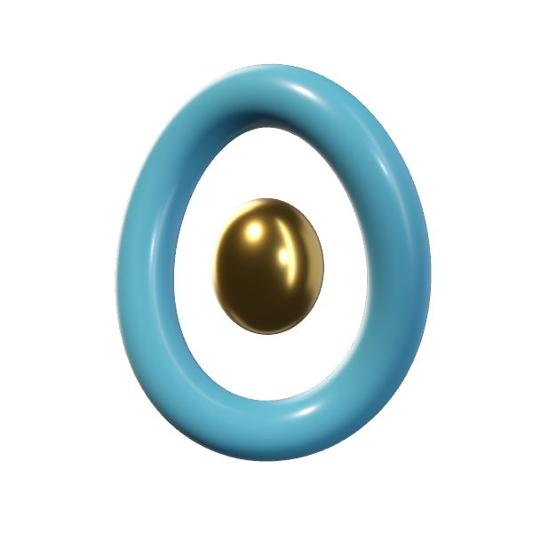
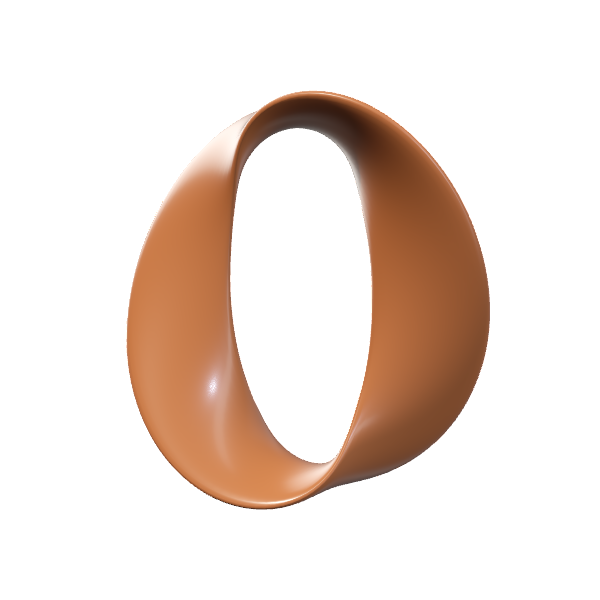
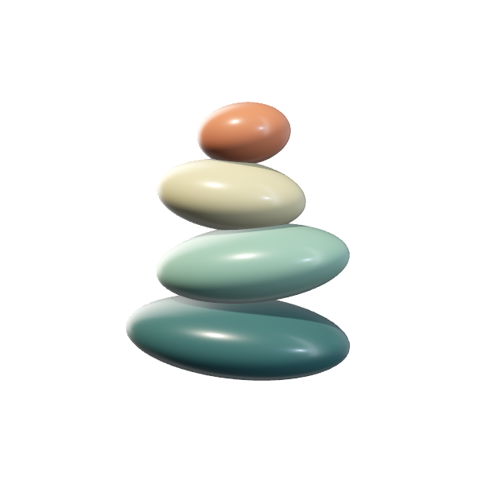

# Reusable native shape examples

Element Studio now includes three original neutral forms alongside the sixteen Daybeat examples. Their geometry is generated in Swift and rendered by RealityKit. There is no JavaScript or browser step for building or testing these forms. Original code and shapes are open source under the repository's [MIT license](../LICENSE).

<p>
  
  
  
</p>

These are actual transparent RealityKit renders captured on an iPhone 16 Pro Max, not concept images.

| Form | Construction | What to adapt |
| --- | --- | --- |
| Orbit | Elliptical tube following a slightly undulating loop, with an independent polished ellipsoid core | Loop radii, circular section, out-of-plane wave, core size/material, component separation |
| Twisted loop | A closed elliptical sweep whose broad thin section makes one full turn | Section width/thickness, loop proportions, twist, ceramic finish |
| Stacked pebbles | Four rotated ellipsoids with separate ceramic colors and offsets | Radii, centers, rotation, palette, exploded presentation |

## Copy into another app

Copy [StudioExampleShapes.swift](../Sources/StudioExampleShapes.swift) into your Swift target and preserve its MIT notice plus [LICENSE](../LICENSE). It imports only Foundation and simd, returning positions, normals, UVs, triangle indices, and material-role metadata. It has no dependency on the Element Studio library, Daybeat, accounts, or browser tooling. Use a toolchain supporting the source's Swift 6 concurrency annotations.

For each part from `StudioExampleShapes.make(id: "orbit-v1")`, feed its mesh arrays to your renderer. A RealityKit integration follows the same pattern as Element Studio:

```swift
var descriptor = MeshDescriptor(name: part.name)
descriptor.positions = .init(part.mesh.positions)
descriptor.normals = .init(part.mesh.normals)
descriptor.textureCoordinates = .init(part.mesh.uv)
descriptor.primitives = .triangles(part.mesh.indices)
let mesh = try await MeshResource(from: [descriptor])
// Build a ModelEntity with your PBR material and add it to your scene.
```

Import RealityKit in the consuming file. The snippet runs in an async scene-setup context with `part` supplied by the generator. [StudioExampleAsset.swift](../Sources/StudioExampleAsset.swift) adapts the same data to this app's packed mesh contract; [the renderer](../Sources/ElementStudioRenderer.swift) owns native materials, lighting, shadows, camera, and render lifetime.

The stock IDs end in `-v1`. Preserve those generators for saved looks; give changed geometry a new ID. Material/light controls change the existing entities without regenerating meshes. For a new shape, change a copy's construction parameters in source and register a new ID/name. Keep radii and section sizes positive, leave room inside a loop to avoid self-intersection, and verify the result natively before shipping arbitrary parameter changes.

## Construction lessons

- Closed sweeps duplicate seam vertices for UVs but reuse the same endpoint positions and normals. The full twist is orientable; a half twist requires a different surface/thickness construction and cannot simply reuse this seam contract.
- Loop normals come from the cross product of local surface derivatives, so the changing frame, elliptical section, and twist participate in the shading normal.
- Ellipsoids transform sphere normals by inverse scale and then rotation. A single vertex at each pole avoids the zero-area triangles produced by collapsed latitude rows.
- Parts own their material roles and separation vectors. The twisted band is one continuous part, so Separate components intentionally has no effect on it.
- The launch previews are native transparent snapshots. They are replaced by the persistent live renderer once GPU warmup completes.

## Verify changes

Follow [native validation](NATIVE-VALIDATION.md). `ExampleShapeTests` checks finite geometry, index bounds, nondegenerate triangles, normal/winding agreement, closed welded seams, deterministic buffers, preserved IDs across editions, save/import/relaunch, and native renders with transparent and opaque pixels. `testNativeExampleShapesAndSavedLook` exercises all three through Surface, Light, Form, rotation, and save/reopen on a simulator or connected iPhone. The existing Daybeat tests remain in place.

The camera/lighting controls are artistic, and these examples are not a rigid-body balancing simulation. Normal-map filtering and lighting still need visual review on the intended hardware.
