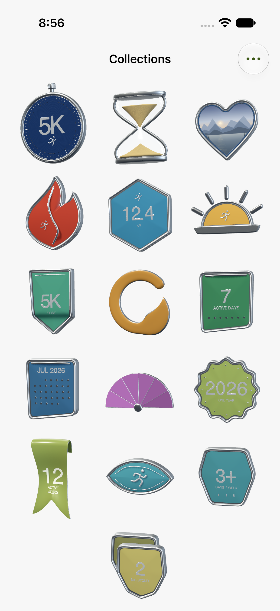
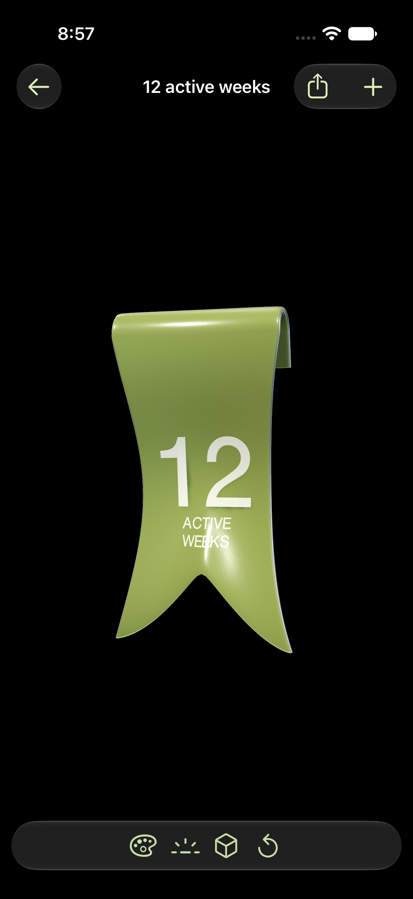
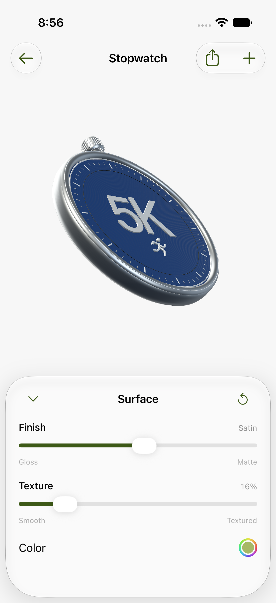

# Element Studio for iPhone

A standalone, native iOS studio for developing 3D elements, materials and Metal shaders, and keeping repeatable visual configurations. Open `ElementStudio.xcodeproj` and select the `ElementStudio` scheme. The Debug app appears on the phone as **Element Studio**, with bundle ID `com.anoop.elementstudio.dev` and its own library. It does not read Daywake data.

<p>
  
  
  
</p>

[Interaction review and validation](Documentation/REVIEW.md)

## Using the app

- **Home:** all sixteen elements share a three-column live 3D canvas. The last row is centered. Drag with one finger to rotate them together, pinch to zoom under your fingers, and drag with two fingers to move around. Zoom out stops at the fitted 1× view; pan limits tighten as you zoom out, so the canvas cannot drift away. Show all resets the view. There is no search or bottom home toolbar.
- **Appearance:** follows System, with Light and Dark overrides in the top menu. Light uses a pale gray canvas; Dark uses pure black.
- **Tilt with iPhone:** bounded, smoothed gyro movement is on by default. The top menu can disable it. Motion stops in the background and with Reduce Motion.
- **Open an element:** tap it to move the camera directly toward that same live object. The scene stays alive; there is no intermediate screen, automatic spin, or per-object preparation message. Back restores the collection's zoom and position. Reduce Motion skips the camera flight.
- **Bottom tools:** Surface, Light and Form use the official bottom toolbar, placed near the home indicator. Selecting one opens native controls with a zoom transition from the toolbar. The downward chevron collapses them; the live viewport remains usable above the controls.
- **Reset edits:** the counterclockwise arrow restores the selected object’s original material, lighting, form and camera. Saved looks remain intact. Save (+) still stores a named version.
- **Surface:** Finish, Texture and Color. Design editions, material types and shape-study selectors have been removed from the editing surface. Existing saved looks retain their original geometry and material settings.
- **Light:** direction and brightness.
- **Form:** depth, separated components and mesh inspection.
- **Collections:** use the top menu to select, create, edit or delete a collection. Filtering reuses the live scene.
- **Share look:** the upper-right share control renders a clean 1440 × 1440 image of the current object and camera. Inspect the preview, then use Share image to choose the destination. Opening the preview does not send anything.
- **Save look (+):** name the current version and choose a collection. Each version keeps geometry edition, study, color, material, lighting, form, and camera angle. Its thumbnail is rendered from that saved state.
- **Looks:** reopen, rename, favorite, duplicate, and delete saved versions. Export a JSON library through Files or import one. Imports add copies without replacing existing looks.

The catalogue contains 16 authored objects, the latest Daywake geometry, three preserved prior editions, and six Comeback/ribbon studies. The 11 September update imports 20 current variants from Daywake’s native studio. Previous New forms geometry remains under -forms20260910 resource names, preserving older saved looks. This is a visual authoring library with bounded controls, not a general polygon modelling application. New mesh families are added in source. There is no account or cloud synchronization; use Export library to keep a portable backup.

## Source of truth

This repository is the canonical home for future app and shader work. The earlier copy inside Daywake is an extraction snapshot. Start with [the architecture guide](Documentation/ARCHITECTURE.md) for shader and renderer entry points.


- `Sources/`: native SwiftUI library, editor, RealityKit/Metal renderer and settings model.
- `Resources/`: authored native geometry fixtures, preserved editions and textures; the app runs fully offline.
- `Authoring/`: editable browser mesh builders and reference studio, including its vendored dependencies and licenses.
- `export-meshes.cjs`: developer conversion of authored browser geometry to native vertex/index buffers. It requires Node, Playwright and Chrome. Serve `Authoring` locally and pass that URL explicitly. The default export updates current geometry; preserve previous versions under a new edition before changing existing looks' geometry.
- `Tests/` and `UITests/`: library round-trip, import isolation, geometry validation, and the create/save/relaunch/open flow.
- `Documentation/`: architecture and review notes. Local `Review/` logs and captures are gitignored.

User configurations are stored atomically at `Application Support/Element Studio/library.json` in the app sandbox. Rendered previews live beside it in `Previews`. Workspace changes autosave; explicitly saved looks remain separate versions. Reinstall updates over the same bundle ID. Do not uninstall the app to update it.

## Build and verify

From this repository:

```sh
env DEVELOPER_DIR=/Users/anoop/Downloads/Xcode-beta.app/Contents/Developer \
  xcodebuild -project ElementStudio.xcodeproj \
  -scheme ElementStudio \
  -destination 'platform=iOS Simulator,name=iPhone 17 Pro,OS=27.0' \
  -derivedDataPath build build
```

Replace `build` with `test` to run the tests. Keep DerivedData warm. Use `project.yml` with XcodeGen when changing project structure. iOS 26.0 is the minimum supported version.

For an automatically signed phone build use `-destination 'generic/platform=iOS' -configuration Debug -allowProvisioningUpdates`. Install `build/Build/Products/Debug-iphoneos/ElementStudio.app` over the existing Element Studio installation.

Materials are real-time approximations: glass uses a custom shader, and finish/detail controls are bounded artistic settings. Judge the final effect on the target phone as well as in the simulator.
