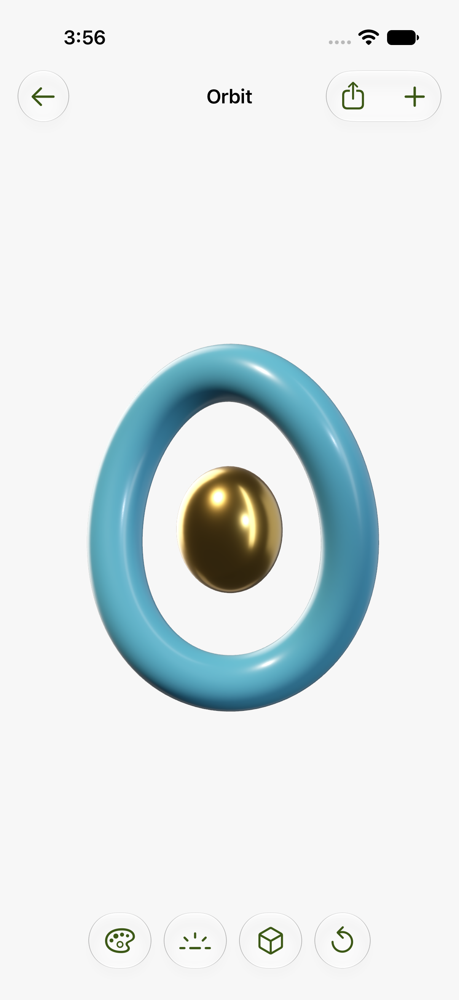
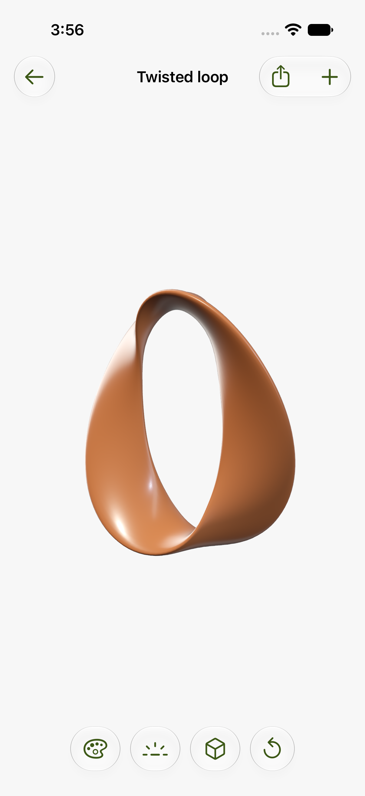
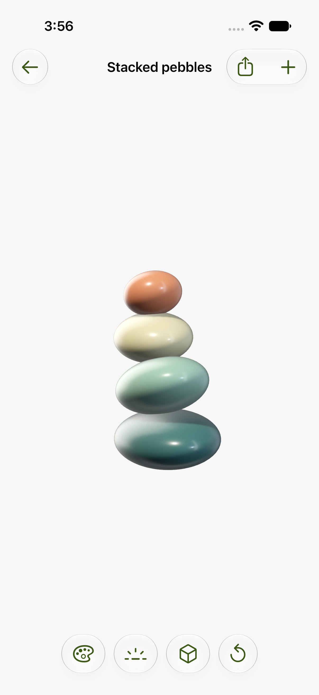
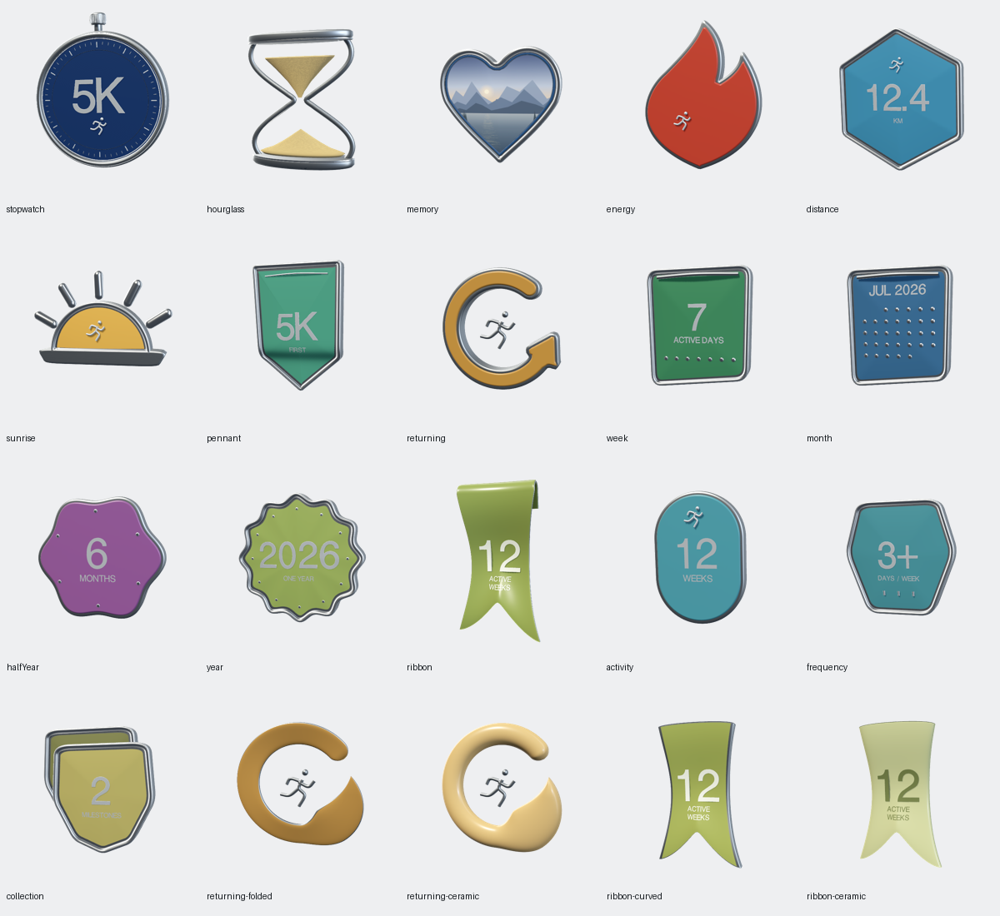

# Element Studio

A native iOS studio for building editable 3D objects with SwiftUI, RealityKit, and Metal. **All shape generators are Swift**, including the original Daybeat collection. Explore **19 examples**, tune their materials and lighting, and save repeatable looks. Reuse the geometry, shaders, and agent skills in your own projects.

Open source under [MIT](LICENSE), with [third-party notices](THIRD-PARTY.md) retained. No Daybeat app, HealthKit data, or account is required.

## New shapes

| Orbit | Twisted loop | Stacked pebbles |
| --- | --- | --- |
|  |  |  |

Actual native iOS Simulator screenshots from the new-shape UI test. These three forms join the original 16 Daybeat examples. Their [standalone Swift generator and construction guide](Documentation/NATIVE-SHAPES.md) explain how to copy, adapt, and render them in another app.

## Native authoring



Actual RealityKit simulator renders of the Swift catalogue.

Shape authoring and rendering use Swift, CoreGraphics, RealityKit and Metal. The repository contains all 16 Daybeat examples, their Comeback/ribbon variants, and the three neutral shapes above. Browser tools and JavaScript dependencies have been removed. Python remains for installation, validation, test orchestration, and optional offline lighting/normal-map generation.

On a Mac with full Xcode and Swift 6:

```sh
swift test
swift run -c release ElementStudioAuthor --output build/mesh-export
python3 scripts/check_repository.py --geometry build/mesh-export
```

This exports all 20 Daybeat object/study variants as native mesh candidates. Use `--ids energy,ribbon-ceramic` for selected recipes, or `--live` for geometry without fixture inscriptions. See the [native authoring guide](NativeAuthoring/README.md) for source entry points, adaptation, versioning, and simulator review. Published geometry stays intact for existing saved looks; new work uses the Swift v1 edition.

## Install and use the agent skills

The skills preserve the techniques behind the hand-tuned geometry, materials, lighting, shaders, and native interactions. They are self-contained Markdown packages that work in your own project. You can install them for automatic discovery or ask any coding agent to read them directly.

| Skill | Start here when you want to… |
| --- | --- |
| [element-studio](skills/element-studio/SKILL.md) | Build and refine an editable 3D object, including controls, undo, saved looks, export, and native verification |
| [procedural-3d-geometry](skills/procedural-3d-geometry/SKILL.md) | Construct swept, lathed, beveled, or assembled meshes with clean normals, seams, and fitted inscriptions |
| [realitykit-materials-lighting](skills/realitykit-materials-lighting/SKILL.md) | Tune PBR materials, reflections, HDR lighting, normal maps, and RealityKit Metal material shaders |

### 1. Get the repository

Install [Git](https://git-scm.com/downloads) and [Python 3](https://www.python.org/downloads/), then run:

```sh
git clone https://github.com/Anoop-design/element-studio.git
cd element-studio
```

The skill installer uses only Python's standard library. Reading or installing the skills does not require Xcode, Node, or the iOS app. Building and visually testing native iOS code requires macOS, full Xcode, and an iOS 26+ simulator or connected iPhone.

### 2. Install all three skills

Run **one** of these commands from the cloned `element-studio` directory. Each installs the skills for your user account so they are available across projects.

**Codex**

```sh
python3 scripts/install-skills.py --destination "$HOME/.agents/skills"
```

**Claude Code**

```sh
python3 scripts/install-skills.py --destination "$HOME/.claude/skills"
```

To install for just one project instead, pass that project's absolute path:

| Agent | Project-only destination |
| --- | --- |
| Codex | `/absolute/path/to/your-project/.agents/skills` |
| Claude Code | `/absolute/path/to/your-project/.claude/skills` |
| Another agent | Its documented skill directory, or use the files directly as described below |

For example:

```sh
python3 scripts/install-skills.py --destination /absolute/path/to/your-project/.agents/skills
```

Successful installation prints `Installed` for `element-studio`, `procedural-3d-geometry`, and `realitykit-materials-lighting`. The installer copies each complete package, including its references and MIT license. It **refuses to overwrite an existing skill**. If a name already exists, compare or back up that directory before replacing it, or choose a different project destination. It does not edit your agent's configuration.

### 3. Ask your agent to use a skill

Open the project you want to work on in your agent, then use an explicit skill invocation:

**Codex prompt**

```text
$element-studio Build an editable ceramic orbit with a separate polished
metal core in this iOS project. Use $procedural-3d-geometry for the mesh
and $realitykit-materials-lighting for the materials and lighting.
Verify the result in an iOS simulator and show the native captures.
```

**Claude Code prompt**

```text
/element-studio Build an editable ceramic orbit with a separate polished
metal core in this iOS project. Use the procedural-3d-geometry and
realitykit-materials-lighting skills as needed. Verify the result in an
iOS simulator and show the native captures.
```

You can also invoke a focused skill directly, such as `$procedural-3d-geometry` in Codex or `/realitykit-materials-lighting` in Claude Code. If your agent does not list a newly installed skill, start a fresh session and check that the destination contains `<skill-name>/SKILL.md`. You can always use the direct-file method below.

Install locations and invocation syntax follow the official [Codex skills guide](https://learn.chatgpt.com/docs/build-skills) and [Claude Code skills guide](https://code.claude.com/docs/en/skills).

### Use with any other coding agent

No installation or plugin is required if your agent can read files. Open this checkout in your agent, or give it access to a complete skill directory, then paste:

```text
Read skills/element-studio/SKILL.md and the relevant linked references.
Use procedural-3d-geometry and realitykit-materials-lighting when needed.
In my iOS project, build a ceramic orbit with a separate metal core,
editable light direction and finish, and native SwiftUI controls.
Build and verify it in an iOS simulator, and show the native captures.
```

For another project, replace the paths with the location of your checkout or installed skills. Keep each skill's entire directory, including `references/` and `LICENSE`, together. If the agent cannot run Xcode, it can still use the construction guidance and produce code; native rendering remains unverified until run on a Mac.

The included workflow delegates research to available **Luna** subagents in Codex, or **Haiku/Sonnet** in Claude Code, with concise findings returned to the main agent. Model availability depends on your environment; installation does not change agent settings or purchase API access. See [skill details and troubleshooting](skills/README.md), the [learning map](Documentation/LEARNING-MAP.md), and the [release and validation record](Documentation/OPEN-SOURCE.md).

## Using the app

Open `ElementStudio.xcodeproj` and select the `ElementStudio` scheme. The Debug app appears as **Element Studio**, with bundle ID `com.anoop.elementstudio.dev` and its own library. It does not read Daywake data.

<p>
  
  
  
</p>

[Interaction review and validation](Documentation/REVIEW.md)

- **Home:** all nineteen elements share a three-column live 3D canvas. The last row is centered. Drag with one finger to rotate them together, pinch to zoom under your fingers, and drag with two fingers to move around. Zoom out stops at the fitted 1× view; pan limits tighten as you zoom out, so the canvas cannot drift away. Show all resets the view. There is no search or bottom home toolbar.
- **Appearance:** follows System, with Light and Dark overrides in the top menu. Light uses a pale gray canvas; Dark uses pure black.
- **Tilt with iPhone:** bounded, smoothed gyro movement is on by default. The top menu can disable it. Motion stops in the background and with Reduce Motion.
- **Open an element:** tap it to move the camera directly toward that same live object. The scene stays alive; there is no intermediate screen, automatic spin, or per-object preparation message. A non-bouncing native spring carries the same object from its grid position into focus. Closing returns to the exact collection zoom and position, with edited depth and separated parts easing back into the grid. Reversing a transition carries its current motion forward smoothly. Closing with a tool expanded keeps its native toolbar transition intact. Reduce Motion skips the camera flight.
- **Bottom tools:** Surface, Light and Form each have their own native glass button, with Reset separate beside them. The centered controls fit their contents near the home indicator. Selecting a tool opens native controls with a zoom transition from that specific button. The downward chevron collapses them; the live viewport remains usable above the controls.
- **Undo and reset:** the counterclockwise arrow opens Undo, Redo, Reset view, and Reset all edits. Inside a tool it also offers Reset surface/light/form. A complete slider drag or color-picking session is one undoable edit. Reset view keeps your finish; Reset edits keeps your camera. Saved looks remain intact.
- **Surface:** Finish describes Gloss, Satin or Matte; Texture controls fine surface detail. Color shows the actual original color palette and opens Apple’s native picker. The original palette is available by holding the Color row. Tap any displayed control value to enter an exact number. A small mark and subtle detent identify the original slider value. Hold to compare temporarily shows the original appearance without changing your pose or edits. During a session, returning to an object restores its own controls. Existing saved looks retain their original geometry and material response.
- **Light:** direction and brightness.
- **Form:** depth, separated components and optional mesh inspection. Objects start fully shaded. Show mesh applies only to the current object and clears when you return to Collections, open another object, reset, save, share or restart the app.
- **Collections:** use the top menu to select, create, edit or delete a collection. Filtering reuses the live scene.
- **Share look:** the upper-right share control renders a clean 1440 × 1440 PNG of the current object and camera. Choose Transparent, White or Black, inspect the preview, then use Share PNG to choose the destination. Transparent output retains real alpha. Opening the preview does not send anything.
- **Save look (+):** name the current version and choose a collection. Each version keeps geometry edition, study, color, material, lighting, form, and camera angle. Its thumbnail is rendered from that saved state. A brief Saved confirmation and success haptic acknowledge the completed save.
- **Looks:** reopen, rename, favorite, duplicate, and delete saved versions. Export a JSON library through Files or import one. Imports add copies without replacing existing looks.

The catalogue contains the 16 Daybeat objects plus three original [native Swift shape examples](Documentation/NATIVE-SHAPES.md): Orbit, Twisted loop, and Stacked pebbles. The Daybeat examples retain five preserved prior editions and six Comeback/ribbon studies. The retained Daybeat designs include a continuous enamel flame, a clearer Comeback arrow with its workout symbol, a full six-month medallion, and a numbered activity medal. The alternate Comeback studies also include their workout marks. Swift-generated Daybeat geometry uses `-swift-v1`. Earlier standalone geometry remains under `-studio20260911`, New forms under `-forms20260910`, and other published editions keep their original IDs. Existing saved looks keep their original geometry through the library migration; new looks use the updated shapes. This is a visual authoring library with bounded controls, not a general polygon modelling application. New mesh families are added in source. There is no account or cloud synchronization; use Export library to keep a portable backup.

## Source of truth

This repository is the canonical home for future app and shader work. The earlier copy inside Daywake is an extraction snapshot. Start with [the architecture guide](Documentation/ARCHITECTURE.md) for shader and renderer entry points.


- `Sources/`: native SwiftUI library, editor, RealityKit/Metal renderer, settings model, and independently reusable Swift shape generators.
- `Resources/`: authored native geometry fixtures, preserved editions and textures; the app runs fully offline.
- `NativeAuthoring/`: editable Swift Daybeat recipes, geometry primitives, text/vector paths, procedural textures and the native exporter.
- `Package.swift` and `AuthoringTests/`: dependency-free macOS authoring command and geometry tests. The iOS app itself has no external packages.
- `Tests/` and `UITests/`: library round-trip, import isolation, geometry validation, and the create/save/relaunch/open flow.
- `Documentation/`: architecture and review notes. Local `Review/` logs and captures are gitignored.

User configurations are stored atomically at `Application Support/Element Studio/library.json` in the app sandbox. Rendered previews live beside it in `Previews`. Workspace changes autosave; explicitly saved looks remain separate versions. Reinstall updates over the same bundle ID. Do not uninstall the app to update it.

## Build and verify

Use full Xcode and an installed iOS 26+ simulator. From the repository root:

```sh
swift test
python3 scripts/check_repository.py
python3 scripts/test-native.py
```

The helper builds the real SwiftUI/RealityKit app and runs unit and UI tests in a dedicated Element Studio QA iPhone simulator. It keeps DerivedData warm and saves logs, test results, and native captures under `build/`. No browser or Node installation is needed for testing.

For a paired, unlocked iPhone, use `python3 scripts/test-native.py --device DEVICE_UDID --team YOUR_TEAM_ID`. No personal signing team is committed. Install updates over the existing bundle ID and use isolated review storage; never uninstall or reset a user's library for QA.

See [native validation](Documentation/NATIVE-VALIDATION.md) for destination discovery, focused tests, signing, device installation, capture commands, and visual acceptance. Use `project.yml` with XcodeGen when changing project structure. iOS 26.0 is the minimum supported version.

Materials are real-time approximations: glass uses a custom shader, and finish/detail controls are bounded artistic settings. Judge the final effect on the target phone as well as in the simulator.

See [CONTRIBUTING.md](CONTRIBUTING.md) for setup, verification, and compatibility expectations. Run `python3 scripts/check_repository.py` to validate skill packaging, documentation links, and native mesh buffers.
